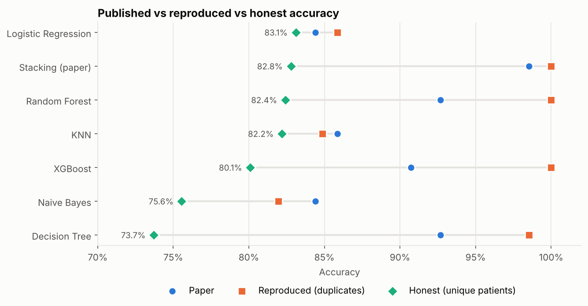
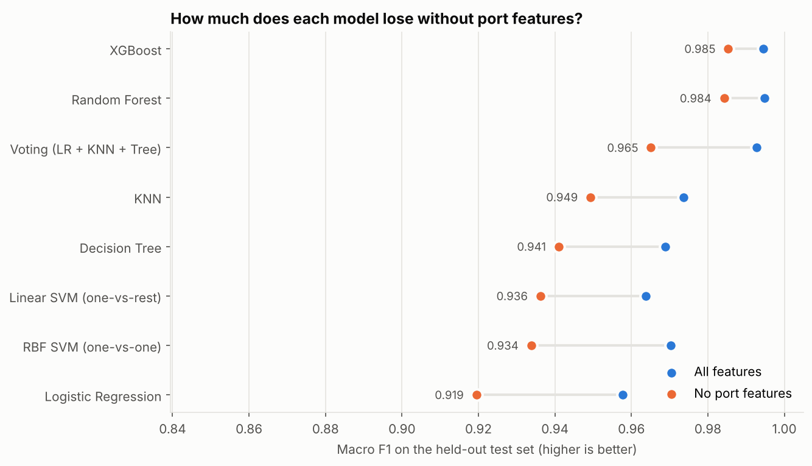

# Data Science Projects

Machine learning and modelling projects in Python. Each folder is a self-contained project with its own README, notebook, data and charts.

## Projects

| Project | What it answers | Tools |
|---|---|---|
| [IoT Network Attack Detection](iot-attack-classification/) | Can a model detect IoT attacks from traffic behaviour, or is it just reading port numbers? | Python, scikit-learn, XGBoost, pandas |
| [Heart Disease Prediction](heart-disease-prediction/) | Does a published 98.5% stacking model hold up, or is it duplicate leakage? | Python, scikit-learn, XGBoost, pandas |

## Highlights

**Heart Disease Prediction:** A published stacking model claimed 98.5% accuracy. With the paper's random split, 202 of 205 test patients also appeared in the training set. Using each patient once, honest accuracy is about 83%, and plain logistic regression does as well as the ensemble.

**IoT Network Attack Detection:** Some attacks always used the same port, so models could score near-perfectly by reading it. Without port features, Random Forest and XGBoost still reach 0.98 macro F1, while logistic regression drops the most.

## Running a project

    cd <project-folder>
    pip install -r requirements.txt
    jupyter notebook
