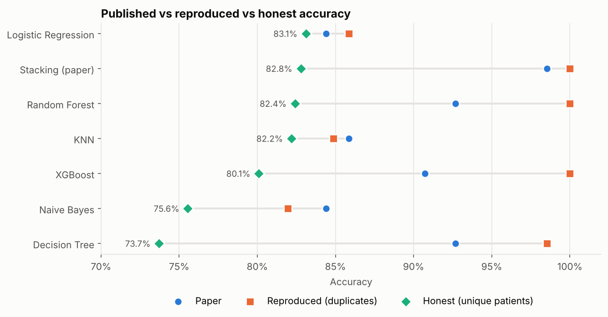
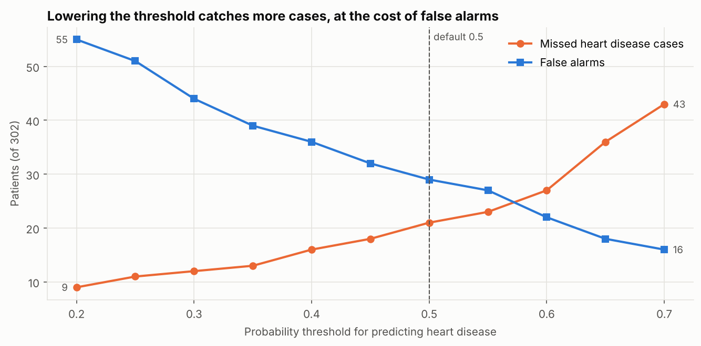
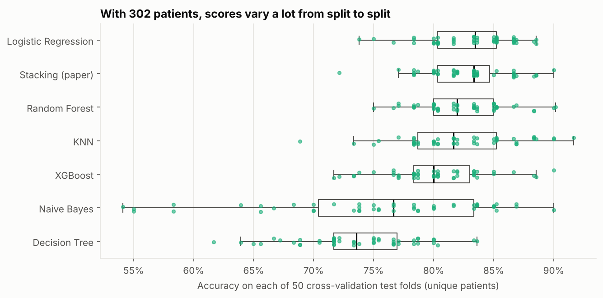

# Does Stacking Really Predict Heart Disease with 98.5% Accuracy?

Reproducing a published heart disease model, finding the duplicate-record leakage behind its near-perfect score, and measuring honest performance.



## The question

A 2024 paper reports that a stacking ensemble predicts heart disease with **98.53% accuracy** on a popular Kaggle dataset of 1,025 patients. Can that be reproduced, and does it hold up?

## What I found

| Finding | Detail |
|---|---|
| The dataset is mostly duplicates | 1,025 rows but only **302 unique patients**; 71% of rows are exact copies |
| The paper's score comes from leakage | With the paper's random 80/20 split, **202 of 205 test patients (99%) also appear in the training set** |
| Reproduction hits 100% | Random Forest, XGBoost and stacking all score a "perfect" 100% on the leaky split |
| Honest accuracy is about 83% | With each patient used once and repeated 5-fold CV, the best models reach 82 to 83% |
| Stacking doesn't help | Plain Logistic Regression (83.1%) matches the 6-model stack (82.8%) |
| The paper's tables have errors | The reported MCC of 1.0 contradicts its own confusion matrix (0.971); its MCC column copies the precision column |
| Threshold matters clinically | Lowering Logistic Regression's threshold from 0.5 to 0.3 cuts missed cases from 21 to 12 out of 164 |

**Recommendation:** Logistic Regression with a lowered threshold. It's as accurate as the ensembles, easy to explain to clinicians, and misses fewer cases when tuned for recall.



## Approach

1. **Reproduced the paper:** same features, preprocessing (scaling and one-hot encoding in a pipeline), 80/20 random split, 6 classifiers and a 5-fold stacking ensemble with a Logistic Regression meta-classifier.
2. **Checked the data:** counted duplicate patients and measured train/test overlap.
3. **Re-evaluated honestly:** deduplicated to 302 patients and ran repeated stratified 5-fold cross-validation (50 splits) for every model.
4. **Analysed the recall trade-off:** used out-of-fold probabilities to see how the threshold changes missed cases and false alarms.



## Limitations

- 302 patients is a small dataset, so differences of 1 to 2 points between models aren't meaningful.
- Models use default hyperparameters, to keep the comparison with the paper fair.
- The paper's random seed isn't published, so the reproduction can't match it exactly.

## Tech stack

Python, pandas, scikit-learn, XGBoost, Matplotlib, Jupyter

## Run it

```bash
cd heart-disease-prediction
pip install -r requirements.txt
jupyter notebook heart_disease_prediction.ipynb
```

The notebook runs in a couple of minutes.

## References

[1] M. Bhagat, A. Sharma and P. Agarwal, "An efficient stacking-based ensemble technique for early heart attack prediction," *Multimedia Tools and Applications*, 2024, doi: 10.1007/s11042-024-19293-7.

[2] A. Janosi, W. Steinbrunn, M. Pfisterer and R. Detrano, "Heart Disease," UCI Machine Learning Repository, 1988, doi: 10.24432/C52P4X.

---
Built for a machine learning unit at Deakin University, then extended to investigate the published results.

[← Back to all projects](../README.md)
