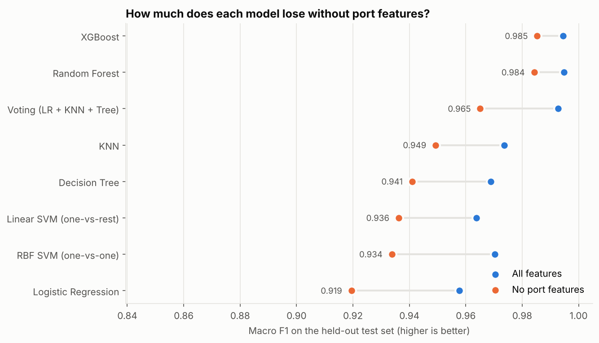
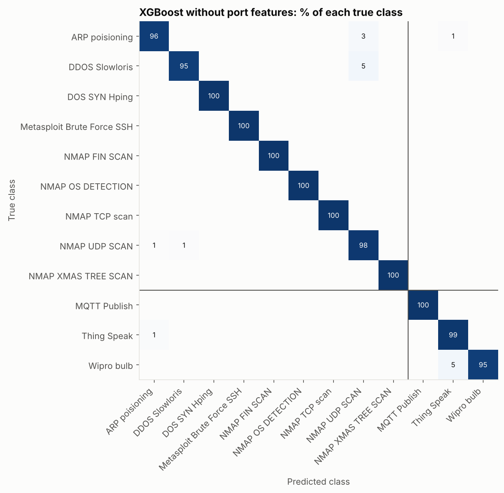
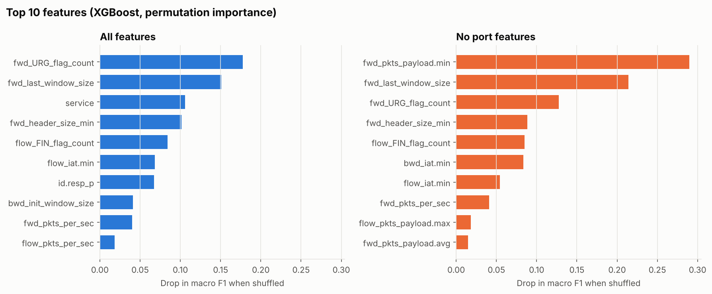

# Detecting IoT Network Attacks: Behaviour or Port Numbers?

Classifying 118,000 IoT network flows into 9 attack types and 3 normal device patterns, and testing whether the models learned real attack behaviour or a shortcut in how the data was captured.



## The question

In this dataset, some attacks always used the same port: every DoS SYN flood flow went to port 21, and almost all MQTT traffic to port 1883. A model can score near-perfect accuracy just by reading the port, which wouldn't work against a real attacker. So the question is: **how well can attacks be detected from traffic behaviour alone?**

## Approach

1. Cleaned the data: dropped 2 unlabelled rows and 5,175 duplicate flows. Missing values are imputed inside the pipeline.
2. Made an 80/20 stratified train/test split. All preprocessing sits in a scikit-learn pipeline fitted on training data only, so nothing leaks from the test set.
3. Tuned 7 models with 3-fold cross-validation on macro F1: Logistic Regression, KNN, Decision Tree, Random Forest, XGBoost, Linear SVM (one-vs-rest) and RBF SVM (one-vs-one). Added a soft-voting ensemble of three different learners.
4. Ran everything twice: **with all features**, and **without port features** (`id.orig_p`, `id.resp_p` and `service`).
5. Evaluated on the held-out test set using **macro F1**, because one class is 76% of the data and accuracy alone is misleading. Also counted missed attacks, and used permutation importance to see which features matter.

## Key findings

| Finding | Detail |
|---|---|
| Tree ensembles learned real behaviour | Without ports, XGBoost only drops from 0.994 to 0.985 macro F1, and Random Forest from 0.995 to 0.984 |
| Simpler models relied on ports more | Logistic Regression drops from 0.958 to 0.919, and the RBF SVM from 0.970 to 0.934 |
| Accuracy hides the gap | Every model scores over 98% accuracy, but macro F1 ranges from 0.919 to 0.985 |
| Very few attacks missed | Random Forest misses 17 of 21,185 attack flows without ports; Logistic Regression misses 98 |
| Features match attack mechanics | Without ports, the top features are payload size, TCP window size and FIN/URG flag counts, which are the signatures of floods and stealth scans |
| SVMs scale poorly | The one-vs-rest Linear SVM took 12 to 18 minutes to train (Random Forest took 6 seconds) and still didn't converge |

**Recommendation:** Random Forest without port features. It has near-top performance and doesn't depend on ports, it's fast to train and score, and it's simple to maintain.





## Limitations

- All traffic comes from a single lab testbed, so testing on another network is the real check of generalisation.
- SSH brute force and FIN scans have fewer than 10 test flows each, so their scores are uncertain.
- For speed, hyperparameters were tuned on a class-capped sample of the training data.

## Data

**RT-IoT2022** from the UCI Machine Learning Repository (CC BY 4.0). Details are in [`data/README.md`](data/README.md).

## Tech stack

Python, pandas, scikit-learn, XGBoost, Matplotlib, Jupyter

## Run it

```bash
cd iot-attack-classification
pip install -r requirements.txt
jupyter notebook iot_attack_classification.ipynb
```

The full notebook takes about 50 minutes on a 2-core machine, mostly because of the Linear SVM.

## Project structure

```
├── data/          # rt_iot2022.csv.gz + data notes
├── images/        # charts used in this README
├── iot_attack_classification.ipynb
├── requirements.txt
└── README.md
```

---
Built for a machine learning unit at Deakin University, then extended with corrected evaluation and the port-feature experiment.

[← Back to all projects](../README.md)
